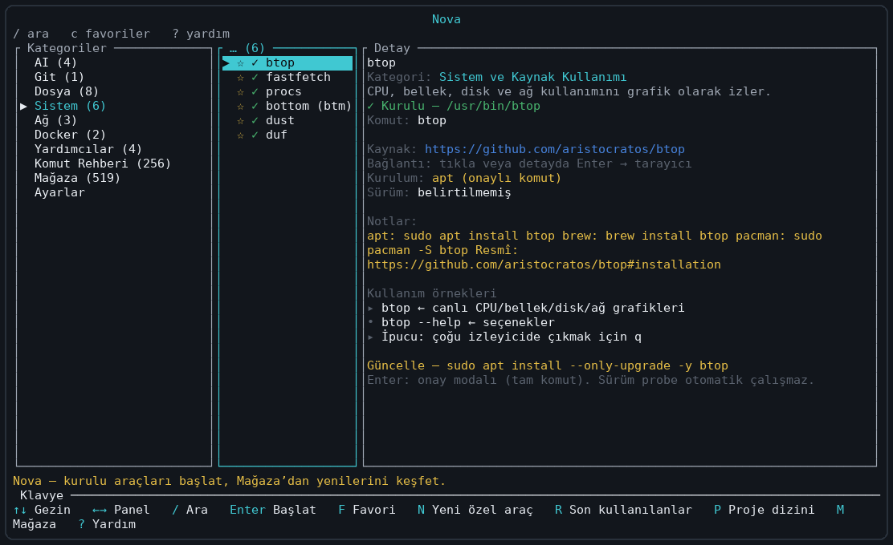
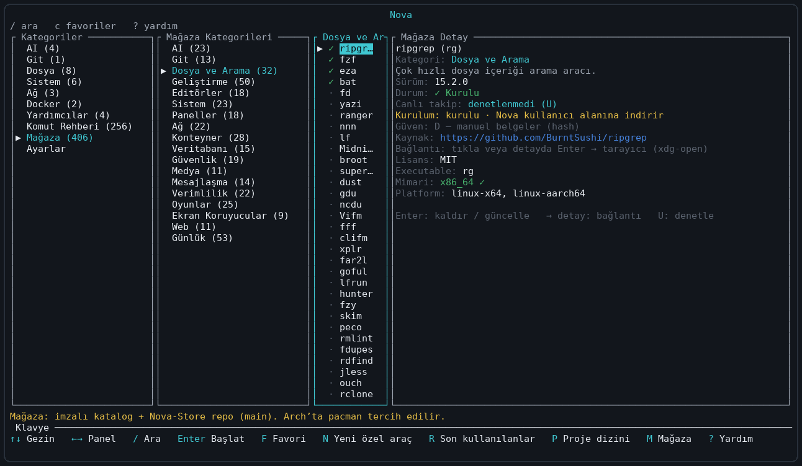
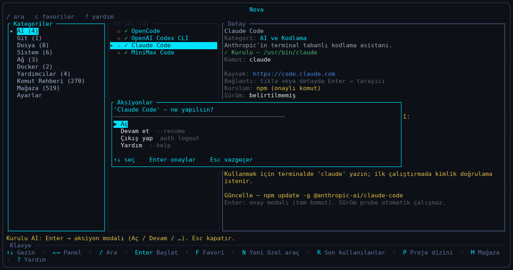
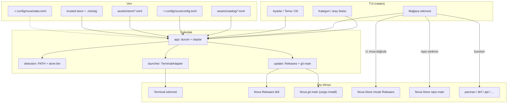
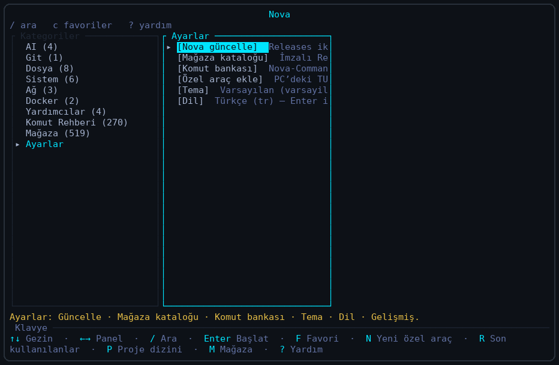

# Nova

<p align="center">
  
</p>

<p align="center">
  <strong>Linux terminal araçlarını keşfet, kur, güncelle — tek TUI’de başlat.</strong><br>
  <em>Kurulu olanlar bir Enter uzakta. Geri kalanı Mağaza’da, imzalı katalogla.</em>
</p>

<p align="center">
  <a href="https://github.com/Teknoloji-Filozoflari/Nova/releases"></a>
  <a href="https://github.com/Teknoloji-Filozoflari/Nova-Store"></a>
  <a href="LICENSE.md"></a>
  
  
</p>

Nova, sık kullandığınız CLI araçlarını **klavye odaklı bir TUI** içinde
kategorilere ayırır. Kurulu araçları yeni bir terminal sekmesinde başlatır;
kurulu olmayanları **Mağaza** üzerinden keşfeder, (mümkünse) kurar ve günceller.
Nova oturumu açık kalır — emülatörünüzün yerini almaz, paket yöneticinizi
değiştirmez; onları bir araya getirir.

> Arch kullanıcıları için: kurulum ve güncellemede **`pacman` tercih edilir**
> (ortamda varsa). Diğer distrolarda `dnf` / `apt` / `brew` / `cargo` /
> `npm` / `pipx` / `uv` yolları da kullanılır.

## Özellikler

| | |
| --- | --- |
| **Başlatıcı katalog** | AI, Git, dosya/arama, sistem, ağ, Docker, yardımcılar, özel araçlar — arama, favoriler, geçmiş, proje dizinleri |
| **Kurulum durumu** | `PATH` + Nova mağaza `bin` taranır; tespit sırasında araç **çalıştırılmaz**. Ana listede yalnızca kurulu olanlar |
| **Mağaza** | Ayrı katalog; arşiv+SHA-256, paket yöneticisi veya resmi yönerge. Arch’ta `pacman` önce |
| **İmzalı + repo katalog** | [Nova-Store](https://github.com/Teknoloji-Filozoflari/Nova-Store) **Releases** (minisign) ve **`main` repo** senkronu — imza doğrulanmazsa uzak Releases verisi uygulanmaz |
| **Nova self-update** | **GitHub Releases** ikilisi *ve* repo **`main`** üzerinden `cargo install --git` (ağ + derleme). İkisi birbirinin yerine geçmez |
| **AI aksiyonları** | Seçili AI aracında detay yanında Aç / Devam / Çıkış / Yardım |
| **Tema + dil** | Dokuz tema; `tr` varsayılan — en / ru / az / uz / kk / tk |
| **Klavye + fare** | Liste tıklama/kaydırma; `Tab`/`Shift+Tab` panel odağı; odaklı panel `-`/`+` ile boyutlanır (ekran başına `state.toml`) |

<p align="center">
  
</p>

## Kurulum

### İkili (önerilen)

[Releases](https://github.com/Teknoloji-Filozoflari/Nova/releases) sayfasından
`nova-v*-x86_64-unknown-linux-gnu.tar.gz` (+ `SHA256SUMS.txt`) indirin:

```bash
tar -xzf nova-v0.1.0-x86_64-unknown-linux-gnu.tar.gz
install -m 755 nova-v0.1.0-x86_64-unknown-linux-gnu/nova ~/.local/bin/nova
```

`~/.local/bin` PATH’te olsun. Sonraki sürümler için **Ayarlar → Nova güncelle**
(`U`) Releases kanalını kullanır; `main`’deki commit’ler için aynı ekranda
**`G`** → `cargo install --git` (ağ + derleme).

### Kaynaktan / repo `main`

```bash
git clone https://github.com/Teknoloji-Filozoflari/Nova.git
cd Nova
cargo run                 # geliştirme
cargo build --release && ./target/release/nova
# veya:
cargo install --git https://github.com/Teknoloji-Filozoflari/Nova.git --branch main --force --locked
```

Gereksinimler: Linux, Rust toolchain, desteklenen bir terminal backend
(`$TERMINAL`, kitty, alacritty, wezterm, gnome-terminal, konsole, foot, xterm,
tmux, …). Emülatör yokken arayüz gezilebilir; başlatma backend bulamazsa hata verir.

## Kullanım

```text
┌──────────────┬──────────────────┬────────────────────────────┐
│ Kategoriler  │ Araçlar / Mağaza │ Ayrıntı / AI eylemleri     │
│  (+ Ayarlar) │                  │                            │
└──────────────┴──────────────────┴────────────────────────────┘
```

| Tuş | İşlev |
| --- | --- |
| `↑`/`↓`, `j`/`k` | Listede gezin |
| `←`/`→`, `h`/`l` | Komşu panele (kenarda durur) |
| `Tab` / `Shift+Tab` | Paneller arası (görsel sırada, başa/sona sarar) |
| `Enter` | Kategoriye gir / başlat / mağazada kur·onay |
| `/` | Ara |
| `f` | Favori |
| `c` / `r` / `p` | Yalnızca favoriler / geçmiş / proje dizinleri |
| `s` | Ayarlar |
| `m` | Mağaza |
| `u` / `U` | Bağlama duyarlı güncelleme (Nova veya Mağaza) |
| `G` | Nova: repo `main` → `cargo install --git` (güncelleme penceresinde) |
| `o` | Dosya seçici |
| `a` | Varsayılan AI CLI |
| `n` / `d` | Özel araç ekle / sil |
| `?` | Yardım |
| `-` / `+` (veya `=`) | Odaklı paneli daralt / genişlet (yatayda genişlik, dikeyde yükseklik); ekran başına `state.toml` → `prefs.pane_sizes` |
| `Esc` / `q` | Geri / çık |

Onay pencerelerinde `Enter` onaylar, `Esc` vazgeçer.

<p align="center">
  
</p>

## Kurulu uygulamalar vs Mağaza

Nova’da **iki katalog** vardır; karıştırmayın:

| | Araç kataloğu (ana liste) | Mağaza |
| --- | --- | --- |
| Kaynak | `assets/catalog/*.toml` + `~/.config/nova/config.toml` | Gömülü `assets/store/*.toml` → imzalı Nova-Store Releases **ve** repo `main` senkronu |
| Amaç | Kurulu araçları başlatmak | Kurulu olmayanları keşfetmek / kurmak / güncellemek |
| Ana listede | Yalnızca kurulu olanlar | Kurulu + kurulabilir / yönergeli |
| Sürüm / checksum | Yok | Var (indirme ve canlı denetim) |

Akış:

1. Nova açılır → kurulum durumu taranır.
2. Kurulu araçlar kategori listesinde → `Enter` ile yeni sekmede başlar.
3. Kurulu olmayanlar Mağaza’da kalır → kaynak, lisans, güven sınıfı, yöntem.
4. Onay sonrası kurulum: arşiv+SHA-256, paket yöneticisi (**Arch’ta `pacman`**), veya yalnızca resmi yönerge.
5. Kurulumdan sonra araç ana katalogda görünür.

**Güven sınıfları (A/B/C/D):** A distro resmi (`pacman`/`dnf`/`apt`), B proje ikili+imza, C kayıt defteri (cargo/npm/pypi) risk notuyla, D yalnızca dokümantasyon. A ile B birleştirilmez.

## Çalışma şeması



Modül sınırları: [ARCHITECTURE.md](ARCHITECTURE.md).

## Ayarlar

`s` ile Ayarlar sekmesi:

<p align="center">
  
</p>

| Bölüm | Ne yapar |
| --- | --- |
| **Nova güncelle** | GitHub **Releases** ikilisini denetler → onayla `~/.local/bin/nova`. Yayın yoksa veya `main` istiyorsanız **`G`**: `cargo install --git` (ağ + derleme; Releases etiketi gerekmez). |
| **Mağaza kataloğu** | İmzalı Nova-Store **Releases** + repo **`main`** senkronu. İmzası geçmeyen Releases gövdesi uygulanmaz. |
| **Özel araç ekle** | Yerel TUI/komutu kataloğa yazmadan kaydet |
| **Tema** | `varsayilan`, `acik`, `orman`, `amber`, `okyanus`, `gece`, `gul`, `arduvaz`, `kizil` |
| **Dil** | `tr` (varsayılan), `en`, `ru`, `az`, `uz`, `kk`, `tk` |

Dil/tema metinleri derleme zamanı tablolarındadır (`src/i18n`).

## Nova-Store

Mağaza kataloğunun uzun vadeli sahibi:

**[Teknoloji-Filozoflari/Nova-Store](https://github.com/Teknoloji-Filozoflari/Nova-Store)**

- Katkı: kategori TOML/JSON PR’ları Nova-Store’a (Nova Rust’ına uygulama kaydı eklemeyin).
- Yayın: CI şema / benzersiz id / SPDX / kaynak URL / kurulum yöntemi doğrular; imzalı `store-catalog.toml` (+ `.minisig`) Releases’a konur.
- Nova: gömülü minisign genel anahtarıyla doğrular (`assets/keys/nova-store-catalog.pub`); başarısızlığa karşı son güvenilen kopyaya düşer. Repo `main` senkronu imzasızdır — UI bunu açıkça belirtir.

| Ortam değişkeni | Anlam |
| --- | --- |
| `NOVA_STORE_DIR` | Mağaza kurulum kökü (varsayılan `~/.local/share/nova/store/`) |
| `NOVA_STORE_CATALOG_URL` / `NOVA_STORE_CATALOG_SIG_URL` | Uzak imzalı katalog / imza |
| `NOVA_STORE_REPO_CATALOG_URL` | Repo `main` katalog JSON override |
| `NOVA_STORE_CATALOG_DISABLE_REMOTE=1` | Uzak katalog denemesini kapat |
| `NOVA_GIT_SOURCE_URL` / `NOVA_GIT_BRANCH` | Nova kaynak güncellemesi (`cargo install --git`) |

## Yapılandırma

| Dosya | Amaç |
| --- | --- |
| `~/.config/nova/config.toml` | Elle araç ayarları ve özel girdiler (Nova üzerine yazmaz) |
| `~/.config/nova/state.toml` | Favoriler, geçmiş, proje dizinleri, dil, tema |

`XDG_CONFIG_HOME` tanımlıysa dosyalar `nova/` altına gider. Bozuk `state.toml`
silinmeden yedeklenir.

```toml
[[tools]]
id = "btop"
favorite = true

[[tools]]
id = "sunucu-gelistirme"
name = "Geliştirme sunucusu"
category = "Özel Araçlar"
executable = "ssh"
args = ["user@host.example"]
description = "Geliştirme sunucusuna bağlanır"
launch_kind = "custom_command"
```

Program ve argümanlar ayrıdır; `args` içinde kabuk genişletmesi / boru /
yönlendirme yoktur. Şema: [ARCHITECTURE.md](ARCHITECTURE.md).

## Güvenlik

- Shell birleştirme yok: `Command` + ayrı argv.
- Tespit için program çalıştırılmaz.
- Mağaza arşivleri: indir → SHA-256 → yol geçişi korumalı çıkarma → kullanıcı alanı.
- İmzası doğrulanmayan uzak Releases kataloğu uygulanmaz.
- Sistem dizinlerine yazmaz; `sudo` yalnızca kullanıcı onaylı sistem PM kurulumlarında (apt/dnf/pacman), kabuksuz argv ile.
- Özel araçlar mevcut kullanıcı yetkileriyle çalışır; Nova onların güvenliğini garanti etmez.

## Ekran görüntüleri

README’deki görseller `ratatui` `TestBackend` ile gerçek `ui::draw`
çıktısından üretilir (mock değil). Yeniden üretmek için:

[`docs/screenshots/README.md`](docs/screenshots/README.md)

## Katkı ve lisans

```bash
cargo fmt --check
cargo clippy --locked --all-targets --all-features -- -D warnings
cargo test --locked
```

Bağımlılık / `deny.toml` değiştiyse: `cargo audit` && `cargo deny check`.

- Süreç: [CONTRIBUTING.md](CONTRIBUTING.md)
- Mimari: [ARCHITECTURE.md](ARCHITECTURE.md)
- Sürümleme: [docs/VERSIONING.md](docs/VERSIONING.md)
- Issues: [GitHub Issues](https://github.com/Teknoloji-Filozoflari/Nova/issues)

SPDX: `MIT OR Apache-2.0` — [MIT](LICENSE-MIT) veya [Apache-2.0](LICENSE-APACHE);
özet [LICENSE.md](LICENSE.md).
