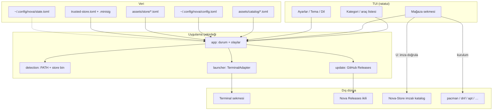

# Nova

<p align="center">
  <strong>Linux terminal araçlarını keşfet, kur, güncelle ve yeni bir terminal sekmesinde başlat.</strong>
</p>

<p align="center">
  <a href="https://github.com/Teknoloji-Filozoflari/Nova/releases"></a>
  <a href="LICENSE.md"></a>
  
  
</p>

Nova, sık kullanılan komut satırı araçlarını **klavye odaklı bir TUI** içinde
kategorilere ayırır. Kurulu araçları anında başlatır; kurulu olmayanları
**Mağaza** üzerinden keşfeder, (mümkünse) kurar ve günceller. Araç yeni bir
terminal sekmesinde açılır; Nova oturumu açık kalır.

Nova bir terminal emülatörü veya sistem paket yöneticisi değildir. Mevcut
araçları yeniden yazmaz — onları bulmayı, güvenle kurmayı ve başlatmayı
kolaylaştırır.

## İçindekiler

- [Özellikler](#özellikler)
- [Kurulum](#kurulum)
- [Kullanım](#kullanım)
- [Kurulu uygulamalar vs Mağaza](#kurulu-uygulamalar-vs-mağaza)
- [Çalışma şeması](#çalışma-şeması)
- [Ayarlar ve i18n](#ayarlar-ve-i18n)
- [Nova-Store](#nova-store)
- [Yapılandırma](#yapılandırma)
- [Güvenlik](#güvenlik)
- [Katkı ve lisans](#katkı-ve-lisans)

## Özellikler

- **Araç kataloğu** — AI, Git, dosya/arama, sistem, ağ, Docker, yardımcılar ve özel araçlar; arama, favoriler, başlatma geçmişi, proje dizinleri.
- **Kurulum durumu** — `PATH` ve Nova mağaza `bin` dizinleri taranır; tespit sırasında araçlar **çalıştırılmaz**. Ana listede yalnızca kurulu olanlar görünür.
- **Mağaza** — ayrı katalog; indirme + SHA-256, paket yöneticisi (`pacman` / `dnf` / `apt` / `brew` / `cargo` / `npm` / `pipx` / `uv`) veya resmi yönerge. Arch’ta `pacman` tercih edilir.
- **İmzalı uzak katalog** — Mağazada `U` ile [Nova-Store](https://github.com/Teknoloji-Filozoflari/Nova-Store) Releases’tan katalog denenir; minisign imzası gömülü anahtarla doğrulanmazsa uzak veri **uygulanmaz**.
- **Self-update** — Ayarlar→Güncelle / araç sekmesinde `U`, GitHub Releases’taki Linux ikilisini onayla `~/.local/bin/nova` kurar.
- **Terminal backend’leri** — `$TERMINAL`, `xdg-terminal-exec`, kitty, alacritty, wezterm, gnome-terminal, konsole, foot, xterm, tmux.
- **Dosya seçici** — `o` ile resim/videoyu ayarlardaki uygulamayla kabuksuz açar.
- **Tema + dil** — dokuz tema; Türkçe varsayılan, English / Русский / Azərbaycan / Oʻzbekcha / Қазақша / Türkmençe.
- **Klavye + fare** — ana listelerde tıklama ve kaydırma; dar pencereye uyumlu düzen.

## Kurulum

### İkili (önerilen)

[Releases](https://github.com/Teknoloji-Filozoflari/Nova/releases) sayfasından
`nova-v*-x86_64-unknown-linux-gnu.tar.gz` indirin:

```bash
tar -xzf nova-v0.1.0-x86_64-unknown-linux-gnu.tar.gz
install -m 755 nova-v0.1.0-x86_64-unknown-linux-gnu/nova ~/.local/bin/nova
```

`~/.local/bin` PATH’te olsun. Sonraki sürümler için Nova içinde
**Ayarlar → Güncelle** (veya araç sekmesinde `U`) aynı kanalı kullanır.
Checksum dosyası (`SHA256SUMS.txt`) yayınla birlikte gelir.

### Kaynaktan

Gereksinimler: Linux, Rust araç zinciri (`cargo` / `rustc`), desteklenen bir
terminal emülatörü (yukarıdaki liste). Katalog yardım metinleri için
`less` veya `more` isteğe bağlıdır.

```bash
git clone https://github.com/Teknoloji-Filozoflari/Nova.git
cd Nova
cargo run            # geliştirme
cargo build --release
./target/release/nova
```

Emülatör yokken arayüz ve katalog gezilebilir; araç başlatma, uygun backend
bulunamazsa hata verir.

## Kullanım

```text
┌──────────────┬──────────────────┬────────────────────────────┐
│ Kategoriler  │ Araçlar          │ Ayrıntı / eylemler         │
│  (+ Mağaza)  │  / Mağaza apps   │                            │
└──────────────┴──────────────────┴────────────────────────────┘
```

| Tuş | İşlev |
| --- | --- |
| `↑`/`↓`, `j`/`k` | Listede gezin |
| `←`/`→`, `h`/`l`, `Tab` | Paneller arası |
| `Enter` | Kategoriye gir / aracı başlat / mağazada kur/onay |
| `/` | Ara |
| `f` | Favori ekle/çıkar |
| `c` | Yalnızca favoriler |
| `r` | Başlatma geçmişi |
| `p` | Proje dizinleri |
| `s` | Ayarlar (Güncelle, Tema, Dil, …) |
| `m` | Mağaza sekmesi |
| `u` / `U` | Bağlama duyarlı güncelleme: araç sekmesinde Nova; mağazada katalog + uygulama sürümleri |
| `o` | Dosya seçici |
| `a` | Varsayılan AI CLI |
| `n` / `d` | Özel araç ekle / sil |
| `?` | Yardım |
| `Esc` / `q` | Geri / çık (`/` aramasında `q` metne yazılır) |

Onay pencerelerinde `Enter` onaylar, `Esc` vazgeçer.

## Kurulu uygulamalar vs Mağaza

Nova’da **iki ayrı katalog** vardır; karıştırmayın:

| | Araç kataloğu | Mağaza |
| --- | --- | --- |
| Kaynak | `assets/catalog/*.toml` (gömülü) + kullanıcı `config.toml` | Gömülü `assets/store/*.toml` → imzası doğrulanmış Nova-Store yayını |
| Amaç | Kurulu araçları başlatmak | Kurulu olmayanları keşfetmek / kurmak / güncellemek |
| Ana listede | Yalnızca kurulu olanlar | Kurulu + kurulabilir / yönergeli kayıtlar |
| Sürüm / checksum | Yok | Var (indirme ve canlı denetim için) |

Akış kısaca:

1. Nova açılır → kurulum durumu taranır.
2. Kurulu araçlar kategori listesinde görünür → `Enter` ile yeni sekmede başlar.
3. Kurulu olmayanlar Mağaza’da kalır → kaynak, lisans, güven sınıfı ve yöntem incelenir.
4. Onay sonrası kurulum: arşiv+SHA-256, paket yöneticisi (Arch’ta `pacman`) veya yalnızca resmi yönerge.
5. Kurulumdan sonra araç ana katalogda görünür.

**Güven sınıfları (A/B/C/D):** A distro resmi (`pacman`/`dnf`/`apt`), B proje ikili+imza, C kayıt defteri (cargo/npm/pypi) risk notuyla, D yalnızca dokümantasyon. A ile B birleştirilmez.

## Çalışma şeması



Modül sınırları ve tasarım kararları: [ARCHITECTURE.md](ARCHITECTURE.md).

## Ayarlar ve i18n

`s` ile Ayarlar sekmesi:

| Bölüm | Ne yapar |
| --- | --- |
| Güncelle | `Teknoloji-Filozoflari/Nova` Releases’ı sorgular; uygun Linux ikilisi varsa onayla `~/.local/bin/nova` kurar. Yayın yoksa bunu açıkça bildirir (sessiz no-op yok). |
| Tema | `varsayilan`, `acik`, `orman`, `amber`, `okyanus`, `gece`, `gul`, `arduvaz`, `kizil` — `state.toml`’a yazılır. |
| Dil | `tr` (varsayılan), `en`, `ru`, `az`, `uz`, `kk`, `tk`. |
| Gelişmiş | Varsayılan AI CLI, medya uygulamaları, tercih edilen terminal vb. |

Dil ve tema çalışma anında dosyadan okunmaz; metinler derleme zamanı tablolarındadır (`src/i18n`).

## Nova-Store

Mağaza kataloğunun uzun vadeli sahibi ayrı depodur:

**[Teknoloji-Filozoflari/Nova-Store](https://github.com/Teknoloji-Filozoflari/Nova-Store)**

- Katkı: kategori TOML/JSON PR’ları Nova-Store’a (Nova Rust’ına uygulama kaydı eklemeyin).
- Yayın: CI şema / benzersiz id / SPDX / kaynak URL / kurulum yöntemi doğrular; imzalı `store-catalog.toml` (+ `.minisig`) Releases’a konur.
- Nova: gömülü minisign genel anahtarıyla doğrular (`assets/keys/nova-store-catalog.pub`); başarısızlığa karşı son güvenilen kopyaya düşer.

Ortam değişkenleri (isteğe bağlı):

| Değişken | Anlam |
| --- | --- |
| `NOVA_STORE_DIR` | Mağaza kurulum kökü (varsayılan `~/.local/share/nova/store/`) |
| `NOVA_STORE_CATALOG_URL` / `NOVA_STORE_CATALOG_SIG_URL` | Uzak katalog / imza adresi |
| `NOVA_STORE_CATALOG_DISABLE_REMOTE=1` | Uzak katalog denemesini kapat |

## Yapılandırma

| Dosya | Amaç |
| --- | --- |
| `~/.config/nova/config.toml` | Elle düzenlenen araç ayarları ve özel girdiler (Nova üzerine yazmaz) |
| `~/.config/nova/state.toml` | Favoriler, geçmiş, proje dizinleri, dil, tema |

`XDG_CONFIG_HOME` tanımlıysa dosyalar onun altındaki `nova/` dizinine gider.
Bozuk `state.toml` silinmeden yedeklenir.

Örnek:

```toml
[[tools]]
id = "btop"
favorite = true

[[tools]]
id = "sunucu-gelistirme"
name = "Geliştirme sunucusu"
category = "Özel Araçlar"
executable = "ssh"
args = ["user@host.example"]
description = "Geliştirme sunucusuna bağlanır"
launch_kind = "custom_command"
```

Program ve argümanlar ayrı değerlerdir; `args` içinde kabuk genişletmesi /
boru / yönlendirme yoktur. Şema: [ARCHITECTURE.md](ARCHITECTURE.md).

## Güvenlik

- Shell birleştirme yok: `Command` + ayrı argv.
- Tespit için program çalıştırılmaz.
- Mağaza arşivleri: indir → SHA-256 → yol geçişi korumalı çıkarma → kullanıcı alanı.
- İmzası doğrulanmayan uzak katalog uygulanmaz.
- Sistem dizinlerine yazmaz; `sudo` yalnızca kullanıcı onaylı sistem PM kurulumlarında (apt/dnf/pacman), kabuksuz argv ile.
- Özel araçlar mevcut kullanıcı yetkileriyle çalışır; Nova onların güvenliğini garanti etmez.

## Katkı ve lisans

Göndermeden önce:

```bash
cargo fmt --check
cargo clippy --locked --all-targets --all-features -- -D warnings
cargo test --locked
```

Bağımlılık / `deny.toml` değiştiyse: `cargo audit` && `cargo deny check`.

- Süreç: [CONTRIBUTING.md](CONTRIBUTING.md)
- Mimari: [ARCHITECTURE.md](ARCHITECTURE.md)
- Sürümleme: [docs/VERSIONING.md](docs/VERSIONING.md)
- Issues: [GitHub Issues](https://github.com/Teknoloji-Filozoflari/Nova/issues)

SPDX: `MIT OR Apache-2.0` — [MIT](LICENSE-MIT) veya [Apache-2.0](LICENSE-APACHE);
özet [LICENSE.md](LICENSE.md).
